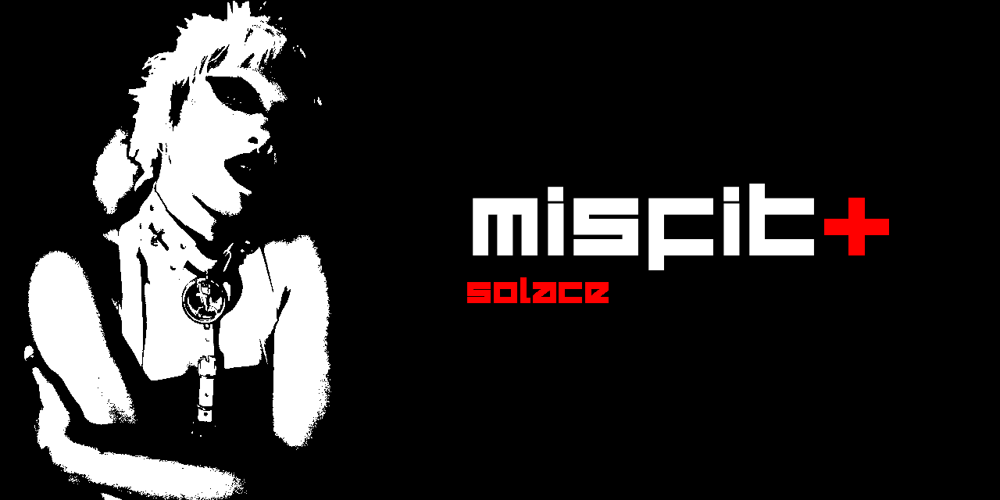

# MISFIT-SOLACE


A zero-dependency, low-bandwidth psychological utility built from first principles in C++. Engineered for isolated, neurodivergent, or compromised individuals operating in high-friction environments. Runs completely client-side via WebAssembly for total data privacy.

## Features
- **[SOLACE]**: Kinetic sensory grounding engine for cognitive realignment.
- **[ECHO]**: Non-allocating in-memory thought shredder with memory-zeroing protocols.
- **[MOMENTUM]**: Low-bandwidth 8-bit daily survival register tracking essential biological actions.

## Local Execution
```bash
g++ -O3 main.cpp -o misfit_solace
./misfit_solace
```

